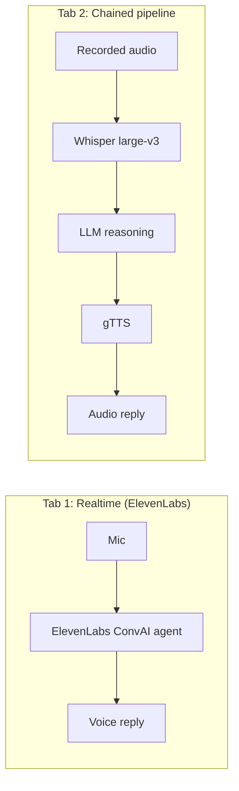

<!-- agent:brain -->
<!-- Commit convention: Conventional Commits with agent scope -->
<!-- Format: type(agent:brain): description -->
<!-- Tags: semantic versioning (v0.1.0, v1.0.0) -->
<!-- Branch: main (PRs for all changes) -->

# Card Dispute Voice Agent (MVP v1.0)

A voice agent prototype for US card dispute servicing under **Regulation E** (debit/EFT) and **Regulation Z** (credit cards). It compares a **realtime speech-to-speech agent** with a **chained STT → LLM → TTS pipeline** side by side, so the trade-offs in latency, conversational feel and control are visible in one app.

> All cardholder names, emails, account IDs and dates of birth in this app are **synthetic test data**. Do not enter real personal or card information.

---

## Why this exists

Card disputes are a high-volume, regulated contact-center journey: the caller must be verified, the dispute type classified (fraud vs. merchant), and every answer kept inside Reg E / Reg Z timelines and policy. Voice agents promise lower handling cost, but the architecture choice drives both customer experience and how much control the bank keeps over what the agent says.

This MVP answers one practical question: **realtime agent or chained pipeline, and what does each cost in latency and control?**

---

## Architecture: realtime vs. chained

The app (Streamlit) has two tabs, one per architecture.

| | **Tab 1: ElevenLabs Conversational AI (realtime)** | **Tab 2: Chained pipeline** |
|---|---|---|
| Flow | Browser mic → ElevenLabs agent (streaming, speech-to-speech) → voice reply | Recorded audio → Whisper ASR → LLM → gTTS → audio reply |
| Models / services | ElevenLabs ConvAI widget (agent configured in ElevenLabs) | `openai/whisper-large-v3` and `openai/gpt-6-luna` via OpenRouter, Google gTTS |
| Conversation feel | Natural turn-taking, barge-in (interrupt mid-sentence) | Turn-based: record, wait, listen |
| Latency | Streaming, low perceived latency | Batch; measured and shown as **Time to TTS Start** |
| Control | Agent prompt, tools and guardrails live in the ElevenLabs agent config | Every stage is visible and swappable in code |
| Data residency | Selectable region: `us`, `eu-residency`, `in-residency`, `global` | Depends on OpenRouter / model provider |



### Realtime tab details
- Embeds the `@elevenlabs/convai-widget-embed` web component, with an automatic **jsDelivr fallback** if unpkg is blocked.
- **Pre-flight check:** calls the ElevenLabs widget config endpoint for the agent ID and shows a clear diagnostic (bad ID, auth required, domain allowlist, wrong region) instead of a silent failure.
- Agent ID, server region and widget height are configurable in the sidebar.

### Chained tab details
- **ASR:** in-memory WAV sent to Whisper large-v3 (no audio written to disk, safe for multi-user cloud hosting).
- **De-duplication:** each recording is SHA-256 fingerprinted so Streamlit reruns never replay the previous question.
- **LLM:** reasoning effort is adjustable (`low` / `medium` / `high`) to show the latency vs. depth trade-off.
- **TTS:** gTTS renders an in-memory MP3 that autoplays.
- **Latency metric:** *Time to TTS Start* is measured end to end; above 1.0s the app flags that a batch chain is slower than streaming or native speech-to-speech.

---

## Reg E / Reg Z test scenarios

The realtime tab ships with four starter prompts that probe verification, dispute handling and policy guardrails. Expected behavior is defined in the ElevenLabs agent configuration; these prompts are how it is exercised.

| # | Scenario | Prompt (abridged) | What it tests |
|---|---|---|---|
| 1 | Open dispute status | "I'm Sarah Miller, email user160@mail.test, DOB 09/22/1991. Status of my StreamCloud dispute?" | Identity verification and claim lookup |
| 2 | Duplicate name / fraud claim | "I'm Sarah Miller on account 42, DOB 04/15/1988. Update on my CityMart fraud dispute?" | Disambiguating two customers with the same name before disclosing anything |
| 3 | Merchant dispute (Reg Z) | "I'm David Brooks... my Flux Online order for $99.08 never arrived. Can I dispute it without locking my card?" | Classifying merchant vs. fraud disputes and explaining options |
| 4 | Policy guardrail (Reg E) | "What is my Reg E provisional credit timeline, and can you credit $200 to my account right now?" | Explaining regulatory timelines while **refusing an unauthorized action** |

> Note: the chained tab uses a generic assistant prompt. It exists to benchmark the pipeline architecture, not to replicate the dispute agent's policy logic.

---

## Synthetic test data

| Acct ID | Test user | Synthetic DOB | Test email | Demo context |
|---|---|---|---|---|
| #42 | Sarah Miller (Test User #1) | 04/15/1988 | user42@example.com | Open CityMart fraud claim ($46.84), flagged account |
| #160 | Sarah Miller (Test User #2) | 09/22/1991 | user160@mail.test | Open StreamCloud claim ($206.11), split PillPath |
| #191 | David Brooks (Test User #3) | 11/03/1984 | user191@mail.test | Won Quick Stop claim, Flux Online ($99.08) |

Users #42 and #160 deliberately share a name to test that the agent verifies with a second identifier (email, account ID or DOB) before sharing account details. No real customer data is used anywhere in this project.

---

## Run locally

```bash
pip install -r requirements.txt
```

Create a `.env` file:

```bash
OPENROUTER_API_KEY=your_openrouter_key      # required for the chained tab
ELEVENLABS_AGENT_ID=your_agent_id           # optional, overrides the default demo agent
```

Start the app:

```bash
streamlit run audio_app_em_updated.py
```

On **Streamlit Community Cloud**, set the same keys under *App Settings → Secrets*.

For the realtime tab, the ElevenLabs agent must allow public widget embeds (authentication off) and include your domain (or `localhost`) in its allowlist.

---

## Tech stack

| Layer | Choice |
|---|---|
| App | Streamlit (>= 1.46) |
| Realtime voice | ElevenLabs Conversational AI widget |
| ASR | Whisper large-v3 via OpenRouter (OpenAI-compatible SDK) |
| LLM | `openai/gpt-6-luna` via OpenRouter, adjustable reasoning effort |
| TTS | gTTS |
| Config | python-dotenv, Streamlit secrets |

---

## Limitations and next steps

- MVP only: no persistence, case system integration or human-agent handoff yet.
- Chained pipeline is batch; a streaming ASR/TTS variant would give a fairer latency comparison.
- Guardrail scenarios are run manually; next step is an automated evaluation suite that scores each scenario on every agent change.

---

*Built by [Swaroop Raj Gunisity](https://linkedin.com/in/swaroopraj) as a hands-on exploration of governed voice agents for regulated financial services.*
